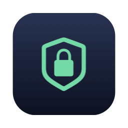
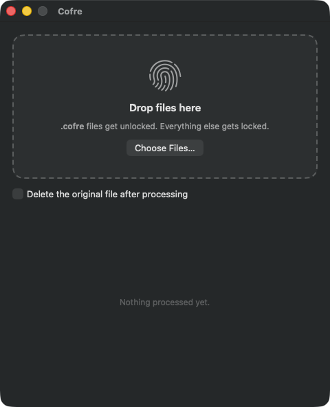

<div align="center">



# Cofre

**Lock any file with your fingerprint.**

Drop a file → touch Touch ID → done. Native macOS, 100% offline, ~1.5 GB/s.

[](https://github.com/roberto-fernandino/cofre/actions/workflows/ci.yml)


[](LICENSE)



</div>

---

*Cofre* is Portuguese for **safe** (the kind with a lock).

Most file encryption tools ask you to make up a password, type it every time, and hope you remember it. Cofre makes the key for you, keeps it in your Mac's Keychain, and unlocks it with **your finger**. Encrypting a file takes about as long as dragging it.

## Features

- 👆 **Touch ID**: one touch per batch, with your Mac password as a fallback.
- ⚡ **Fast**: streams files in 1 MiB chunks, so memory use stays flat and speed reaches about 1.5 GB/s on Apple Silicon. Size doesn't matter, whether it's 10 KB or 50 GB.
- 🔁 **One gesture both ways**: `photo.jpg` becomes `photo.jpg.cofre`, and `photo.jpg.cofre` becomes `photo.jpg` again.
- 🛡️ **Tamper-proof**: a flipped bit, a reordered or truncated chunk, or the wrong key all get caught, and the file is refused.
- 📴 **Offline**: no network code at all. Nothing leaves your Mac and nothing syncs to iCloud.
- 🧩 **Works everywhere in macOS**: drop files on the window or the Dock icon, use *Open With → Cofre* in Finder, or double-click a `.cofre` file.
- 🔑 **Recovery key**: back up one line of text to restore access on a new Mac.
- 🪶 **Small**: about 800 lines of Swift with zero dependencies, using only Apple's CryptoKit. You can audit it in an afternoon.
- 🌎 English and 🇧🇷 Portuguese.

## Install

The fastest way: download **Cofre.zip** from [Releases](https://github.com/roberto-fernandino/cofre/releases), unzip it and move it to Applications.

> The app is not notarized. The first time you open it, right-click it and choose **Open**, or go to **System Settings → Privacy & Security → Open Anyway**.

You can also build it yourself in about 30 seconds. All you need is Xcode or the Command Line Tools:

```bash
git clone https://github.com/roberto-fernandino/cofre.git
cd cofre
./build.sh --install        # → ~/Applications/Cofre.app
```

> [!IMPORTANT]
> Right after your first file, open **Key → Show Recovery Key…** and save the key in your password manager. If this Mac's Keychain is lost, that key is the only way to open your files.

## How it works

```
                       Touch ID
                          │
                          ▼
   Login Keychain ──► master key (256-bit, random, created on first use)
                          │
                          ▼  HKDF-SHA256(master key, random 32-byte salt)
                     per-file key
                          │
                          ▼
   plaintext ──► AES-256-GCM, 1 MiB chunks ──► file.cofre
```

**File format (v1):**

| Bytes | Field |
|---|---|
| 6 | magic `COFRE\0` |
| 1 | version (`1`) |
| 4 | chunk size, big-endian |
| 32 | random salt |
| … | chunks: `ciphertext ‖ 16-byte GCM tag` |

- Each file gets a **fresh key** derived from a random salt, so keys and nonces never repeat across files.
- **Chunk nonce = 88-bit counter ‖ "last chunk" flag.** This is the [STREAM construction](https://eprint.iacr.org/2015/189), so reordering, dropping or truncating chunks makes decryption fail.
- The **header is authenticated** (as AAD) in every chunk.
- Output goes to a temp file and is renamed **only when it's complete**, so a half-written file never appears. Existing files are never overwritten: you get `photo (1).jpg` instead.

All the crypto lives in [`Sources/CofreCore/CofreCipher.swift`](Sources/CofreCore/CofreCipher.swift).

## Threat model

| Scenario | Protected? |
|---|---|
| `.cofre` files on a USB stick, in Dropbox or Google Drive, in email, in a backup | ✅ Yes. Without the key, the files are just AES-256 noise. |
| Someone grabs your unlocked Mac and opens Cofre | ✅ Yes, they need your finger or your Mac password. |
| Someone edits or corrupts a `.cofre` file | ✅ Yes, it's detected and refused. |
| Malware already running as your user | ⚠️ No. See below. |
| You lose the Mac **and** didn't save the recovery key | ❌ The files are gone forever. That's the point of encryption. |

**Why not the Secure Enclave?** Binding the key to the Secure Enclave, so it's released only by biometry, needs keychain entitlements, and those only come with a paid Apple Developer signature. An ad-hoc build gets `errSecMissingEntitlement (-34018)`. So Cofre keeps the key in the login Keychain and requires Touch ID before reading it. A PR that adds an optional Secure Enclave mode for signed builds is very welcome.

## Development

```bash
swift build -c release --product cofre-selftest && .build/release/cofre-selftest
```

The self-test covers round trips at chunk-boundary sizes, flipped bits, truncation, a dropped final chunk, swapped chunks, the wrong key, file naming, and a 512 MiB benchmark:

```
Benchmark (512 MiB):
  encrypt: 0.31s (1629 MB/s) · decrypt: 0.36s (1419 MB/s)
```

```
Sources/
├── CofreCore/       # crypto + file handling (no UI)
├── Cofre/           # SwiftUI app, Touch ID, Keychain
└── cofre-selftest/  # tests + benchmark
```

Releases are built by GitHub Actions: push a `v*` tag and `Cofre.zip` gets attached to a new release.

## Roadmap ideas

- [ ] Optional Secure Enclave mode for Developer ID builds
- [ ] Finder Quick Action ("Lock with Cofre" in the right-click menu)
- [ ] Folder support (automatic zip)
- [ ] `cofre` CLI
- [ ] Encrypted file names

## License

[MIT](LICENSE)
